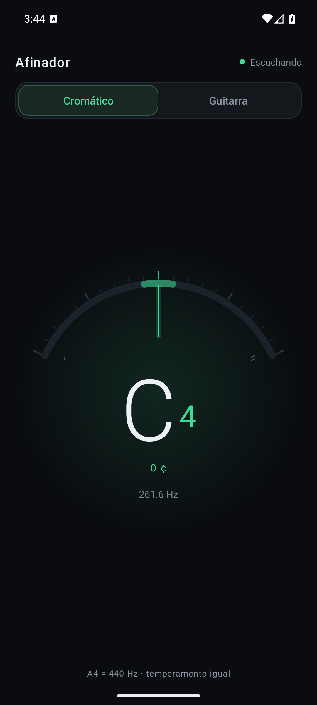
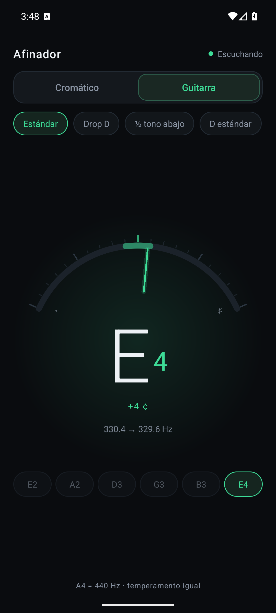

# Afinador

Afinador de instrumentos para Android. Escucha el micrófono, detecta la altura del
sonido y muestra **la nota más cercana** con su desviación exacta en cents, tanto si
es una de las cuerdas de la guitarra como si no.

Interfaz oscura, sin anuncios, sin cuentas, sin telemetría y funciona sin conexión.
Solo pide un permiso: el micrófono.

## Características

- **Modo cromático** — detecta cualquiera de las 12 notas en un rango de 55 Hz a
  1600 Hz (A1 a G6). Muestra nota, octava, frecuencia detectada y desviación en cents,
  aunque la nota tocada no corresponda a ninguna cuerda.
- **Modo guitarra** — nueve afinaciones seleccionables. Las seis cuerdas aparecen como
  objetivos concretos y se resalta la cuerda más cercana al sonido que estás tocando,
  con su nota y su frecuencia objetivo.
- **Medidor de cents** de ±50 con aguja, marcas cada 5 cents y zona verde de ±5 cents
  para saber de un vistazo si está afinada.
- **Detección estable** — mediana móvil y suavizado para que la aguja no salte, con
  puerta de ruido para ignorar el silencio y el ruido de fondo.
- **Pantalla siempre encendida** mientras el afinador está abierto.

## Capturas

<p align="center">
  
  
</p>

A la izquierda, el modo cromático afinando un **C4**: una nota que no es ninguna de las
seis cuerdas. A la derecha, el modo guitarra en afinación estándar, con la cuerda **E4**
detectada y su frecuencia objetivo.

## Instalar en el teléfono

1. Descarga el APK desde [Releases](../../releases).
2. Ábrelo en el teléfono y acepta la instalación de aplicaciones de origen desconocido
   cuando Android lo pida.
3. Al abrir la app, concede el permiso de micrófono.

Requiere Android 6.0 (API 23) o superior. Tamaño del APK: ~90 KB.

## Uso

- **Cromático**: toca cualquier nota y la app muestra la nota más cercana. La aguja a la
  izquierda significa que estás grave; a la derecha, agudo. Verde = afinado.
- **Guitarra**: elige la afinación arriba y toca las cuerdas una por una. La cuerda
  objetivo se resalta y la nota grande es la que debes afinar.

## Afinaciones incluidas

| Afinación | Cuerdas (grave → agudo) |
| --- | --- |
| Estándar | E2 A2 D3 G3 B3 E4 |
| Drop D | D2 A2 D3 G3 B3 E4 |
| ½ tono abajo | D#2 G#2 C#3 F#3 A#3 D#4 |
| D estándar | D2 G2 C3 F3 A3 D4 |
| Drop C | C2 G2 C3 F3 A3 D4 |
| Open G | D2 G2 D3 G3 B3 D4 |
| Open D | D2 A2 D3 F#3 A3 D4 |
| Open E | E2 B2 E3 G#3 B3 E4 |
| DADGAD | D2 A2 D3 G3 A3 D4 |

## Compilar

Requisitos: JDK 17 o superior y el SDK de Android (API 36 y build-tools 36.1.0).

```bash
./gradlew :app:assembleDebug        # APK de depuración
./gradlew :app:testDebugUnitTest    # tests del detector y de la teoría musical
./gradlew :app:assembleRelease      # APK de release (firmado si hay keystore.properties)
```

La firma de release se lee de `keystore.properties` (no se versiona):

```properties
storeFile=afinador-release.jks
storePassword=…
keyAlias=afinador
keyPassword=…
```

Si ese archivo no existe, el build de release usa la clave de depuración para que el
proyecto compile igualmente.

## Cómo funciona

El pipeline es deliberadamente corto y sin dependencias externas:

1. `AudioEngine` captura PCM 16 bits mono a 44,1 kHz en un hilo propio con prioridad de
   audio, calcula el nivel RMS y descarta los frames por debajo del umbral de ruido.
2. `PitchDetector` estima el período con **YIN** (función de diferencia normalizada
   acumulada, umbral 0,12) e interpola parabólicamente la posición del mínimo. YIN es
   mucho más fiable que un pico de FFT en cuerdas pulsadas: evita los saltos de octava
   por el fundamental débil de las cuerdas graves y da precisión sub-muestra, que es lo
   que hace que los cents sean creíbles.
3. `Music` convierte frecuencia a nota MIDI, nombre, octava y cents con temperamento
   igual y A4 = 440 Hz.
4. `MainActivity` estabiliza la lectura (mediana de 5 frames + media exponencial) y
   elige qué mostrar según el modo.
5. `TunerGaugeView` dibuja todo el medidor en un solo `Canvas` para que nota, aguja y
   escala queden siempre alineadas en cualquier tamaño de pantalla.

Rango de detección: 55 Hz – 1600 Hz. Ventana de análisis: 4096 muestras (~93 ms).

## Estructura

```
app/src/main/java/io/github/figs0203/afinador/
├── MainActivity.kt          interfaz, modos, permisos y estabilización
├── audio/AudioEngine.kt     captura de micrófono y bucle de análisis
├── dsp/PitchDetector.kt     YIN (Kotlin puro, testeable en JVM)
├── music/Music.kt           frecuencia ↔ nota, cents
├── music/Tunings.kt         afinaciones y cuerda más cercana
└── ui/TunerGaugeView.kt     medidor dibujado con Canvas
app/src/test/java/…          tests de detección y de afinaciones
```

## Licencia

MIT. Ver [LICENSE](LICENSE).
